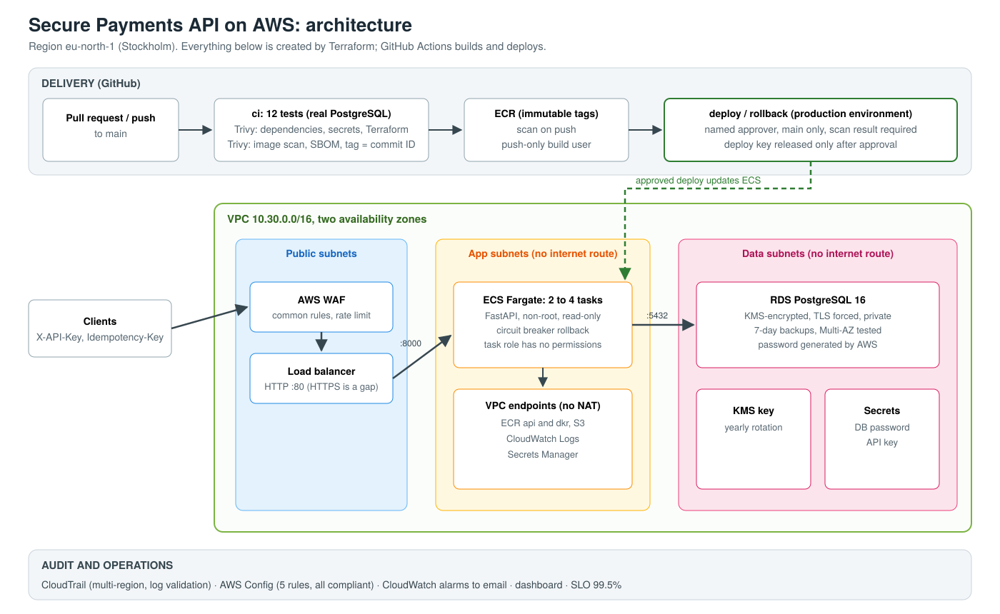

# Secure Payments API on AWS
I built this project to practise how payment teams run services on AWS: a private network, encrypted data, approval before every production change, and proof that rollback and failover really work. I built, broke and fixed everything myself over one week in November 2026, and every number in this README comes from my own tests.

A small payments API on ECS Fargate, with RDS PostgreSQL, an ALB and WAF in front, a scanned CI pipeline, approval-gated deploys, CloudTrail and Config auditing, and CloudWatch alarms.

**Stack:** Terraform · AWS (ECS Fargate, RDS PostgreSQL, ALB, WAF, KMS, Secrets Manager, ECR, CloudTrail, Config, CloudWatch) · GitHub Actions · Trivy · Python (FastAPI)

This is a portfolio project in a lab AWS account. It is not certified against PCI DSS or any other standard.



## Measured results

Every number below was measured in this environment on 17 to 19 November 2026. The evidence is in [`docs/`](docs/).

| Test | Result |
| --- | --- |
| Approved deployment (revision 2 to 4) | Completed in **2 minutes 3 seconds**, **0 of 300** health checks failed |
| Release that crashes on start-up | ECS circuit breaker rolled back by itself after 3 failed tasks in **about 4 minutes**, **0 user errors** |
| Manual rollback (revision 6 to 4) | **3 minutes 0 seconds** from approval to stable |
| Stopping one running task | **90 of 90** health checks returned 200; ECS replaced the task |
| Database Multi-AZ failover under load | Payments failed for **about 10 seconds**: **291 of 300** accepted, 8 returned 500, 1 timed out. AWS reported the failover complete in 48 seconds |
| Point-in-time database restore | Restored to a new encrypted, private instance in **14.2 minutes** (13:47:08 to 14:01:19) |
| Burst of 3,000 requests | Firewall rate limit blocked **3,000 of 3,000** after the first burst |
| Alert path | Forced alarm emailed in about 1 minute; recovery email followed automatically |

## What it shows

**Network.** Three subnet tiers in two availability zones. The app and data subnets have no route to the internet; containers reach AWS through VPC endpoints instead of a NAT gateway. Security groups allow only internet to load balancer (80), load balancer to app (8000) and app to database (5432).

**Data.** PostgreSQL 16 encrypted with a customer-managed KMS key (yearly rotation), TLS forced on every connection, not publicly accessible, 7-day backups. AWS generates the master password and keeps it in Secrets Manager; no person or repository ever sees it.

**Application.** FastAPI on ECS Fargate, 2 to 4 tasks with CPU autoscaling. The container runs as a non-root user with a read-only file system. Secrets are injected at start, the task role has no permissions, and every write needs an API key and an idempotency key, so a retried request never creates a second payment.

**Delivery.** Every pull request runs 12 tests against a real PostgreSQL, a dependency and secret scan, and a Terraform misconfiguration scan. Pushes to `main` also build the image, scan it, write a bill of materials, and push it tagged with the commit ID to a registry with immutable tags. The Trivy action is pinned to a commit ID, because its version tags were hijacked in March 2026.

**Change control.** Deployments and rollbacks run in a GitHub `production` environment that needs a named approver and accepts only `main`. The deploy key is an environment secret, so it is released only after approval. The deploy checks the image was scanned and fails if ECS rolled the release back.

**Audit and operations.** CloudTrail (multi-region, log file validation), AWS Config with 5 rules (all compliant), CloudWatch alarms to email, a dashboard, and a written SLO of 99.5 percent non-5xx requests over 30 days ([`docs/slo.md`](docs/slo.md)).

The full list of controls, each with its evidence, is in [`docs/controls.md`](docs/controls.md). Rollback measurements are in [`docs/rollback.md`](docs/rollback.md).

## Problems found and fixed

Real issues the pipeline or the tests caught while building this:

- **Vulnerable base image.** The image scan blocked a HIGH zlib vulnerability in `python:3.12-slim`; fixed by applying OS security updates at build time.
- **Images ECR could not scan.** Newer Docker pushed an image index with a provenance record, which ECR basic scanning skips. Fixed by pushing a plain manifest (`--provenance=false`).
- **Deploy gate reading an empty field.** AWS's newer basic scanning no longer reports scan status in `DescribeImages`; the deploy check now reads `DescribeImageScanFindings`.
- **Malformed registry address.** A trailing dot in a CI variable produced an image reference ECS could not pull. Rolling deployment kept the old version serving, so users saw no errors; traced from the ECS service events.
- **Terraform drift.** A database parameter showed a change on every plan because AWS and Terraform disagreed on its apply method; pinned `apply_method`.

## Accepted risks and known gaps

Accepted findings are recorded with reasons in [`.trivyignore`](.trivyignore), so none of them pass silently.

- **HTTP only.** HTTPS needs a domain and an ACM certificate. This is the main gap.
- **Load balancer is internet-facing.** By design: it is the only entry point and sits behind WAF.
- **S3-managed encryption** for the Terraform state bucket and the CloudTrail bucket, and an unencrypted alarm topic. Next step: dedicated KMS keys with service-specific key policies (encrypting the topic with the default SNS key would stop CloudWatch from delivering alarms).
- **Long-lived access keys instead of OIDC.** This lab account's organisation policy blocks creating an IAM OIDC provider, so CI uses two least-privilege IAM users: a push-only build user and a deploy user whose key is released only after approval. In a normal account I would use OIDC and remove the keys.
- **Region eu-north-1.** The lab account allows only this region. It is still in the EU.
- **Single approver.** With one person, GitHub's "prevent self-review" cannot be switched on.
- **Password rotation.** ECS reads the database password only when a task starts. The fix in production is fetching the secret per connection or using RDS Proxy.
- **The restored database was not queried,** because it is private. The restore was timed and checked for encryption and privacy.
- **Failed payments during failover were not retried.** A client retry with the same idempotency key would make those 9 requests succeed safely.

## Repository layout

```text
app/                    FastAPI service, Dockerfile, 12 tests
terraform/bootstrap/    Encrypted, versioned S3 bucket for Terraform state
terraform/envs/shared/  Image registry and the two GitHub IAM users (kept between rebuilds)
terraform/envs/dev/     Network, KMS, database, ECS, load balancer, WAF, audit, monitoring
terraform/modules/      network, database, service
.github/workflows/      ci, deploy, rollback, identity-check
docs/                   controls, rollback, SLO, architecture and evidence screenshots
```

## Run the tests

```powershell
cd app
pip install -r requirements-dev.txt
pytest -q
```

Expected: 8 passed and 4 skipped. The 4 database tests run in CI against a real PostgreSQL. `docker-compose.yml` runs the API and a database locally for development.

## Build it

Region eu-north-1. Apply in this order:

1. `terraform/bootstrap`: the state bucket.
2. `terraform/envs/shared`: the registry and the GitHub users. Create their access keys in the console and store them as GitHub secrets (build user as repository secrets, deploy user as `production` environment secrets).
3. Push to `main` so CI builds the first image, then put its tag in `terraform/envs/dev/local.auto.tfvars` with `alert_email`.
4. `terraform/envs/dev`: everything else (about 82 resources, about 20 minutes).

Destroy `envs/dev` at the end of each session; `shared` and `bootstrap` survive.

## What I learned

- A green pipeline is not the same as a working deployment. My deploy check once passed an image that ECR had never scanned, and a rollback can look like a successful deploy. I now verify what is actually running.
- Measuring from the user's side tells a different story. AWS reported the database failover complete in 48 seconds, but my test showed customers were affected for about 10 seconds.
- Not every scanner finding should be "fixed" blindly. Encrypting the alarm topic with the default key would have silently stopped alerts, so I accepted it with a written reason instead.
- Real accounts have limits. My lab account blocked the region and OIDC that I planned to use, so I redesigned around them and documented why.
- Small mistakes cause big failures: one extra dot in a CI variable stopped every new container from starting. Reading the ECS service events found it in minutes.

