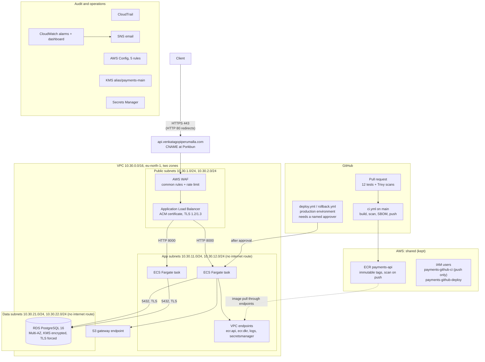
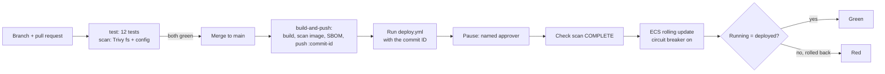

# 02. Architecture

This chapter shows the whole system and follows one request from a client to the database and back.

---

## 1. Diagram

A drawn version is in [`docs/architecture.png`](../architecture.png). **Verified out of date:** that image was made before HTTPS was added and still says "HTTP :80 (HTTPS is a gap)". The Mermaid diagram above is the current design.

---

## 2. The three layers

### Network layer
- **One VPC** (`10.30.0.0/16`) across two availability zones, `eu-north-1a` and `eu-north-1b`.
- **Three subnet tiers**:
  - **Public:** only the load balancer lives here.
  - **App:** the ECS tasks. No route to the internet.
  - **Data:** the database. No route to the internet.
- **No NAT gateway.** The tasks reach AWS services through **VPC endpoints** instead.

### Compute and data layer
- **ECS Fargate** runs 2 to 4 copies (tasks) of the API container.
- **RDS PostgreSQL 16** stores payments, encrypted with a customer-managed KMS key.
- **Secrets Manager** holds the database password and the API key.

### Delivery and control layer
- **GitHub Actions** tests, scans, builds and pushes images.
- **ECR** stores images with immutable tags.
- **Deploy and rollback workflows** need a named approver.
- **CloudTrail, Config and CloudWatch** record, check and alert.

---

## 3. Following one request

A client sends `POST https://api.venkatagopiperumalla.com/payments`.

| Step | What happens | Control |
| --- | --- | --- |
| 1 | DNS at Porkbun resolves `api` (a CNAME) to the load balancer's AWS name | Custom domain |
| 2 | If the client used `http://`, the load balancer replies **301** and sends it to `https://` | No plain HTTP from the internet |
| 3 | TLS is negotiated with the ACM certificate. Only TLS 1.2 and 1.3 are allowed | Encryption in transit |
| 4 | **AWS WAF** checks the request against AWS common attack rules and a rate limit of 2,000 requests per 5 minutes per IP | Web firewall |
| 5 | The load balancer forwards the request on port 8000 to a healthy task in an app subnet | Only the load balancer can reach the tasks |
| 6 | The API checks the `X-API-Key` header against the key from Secrets Manager | Authentication |
| 7 | The API checks the `Idempotency-Key` header and the body (amount, currency, reference) | Input validation, safe retries |
| 8 | The API connects to PostgreSQL on port 5432 with TLS required | Encryption in transit inside the VPC to the database |
| 9 | The insert uses `ON CONFLICT (idempotency_key) DO NOTHING`, so a retry never creates a second payment | Idempotency |
| 10 | The API logs only the payment ID and currency | No sensitive data in logs |
| 11 | The response goes back: **201** for a new payment, **200** for a repeat, **409** if the same key is reused with a different body | Clear client behaviour |

**Known gap:** TLS ends at the load balancer. Step 5, from the load balancer to the task, is plain HTTP inside the VPC.

---

## 4. How a task starts

When ECS starts a new task:

1. ECS uses the **execution role** (`payments-ecs-exec`) to pull the image from ECR through the `ecr.api` and `ecr.dkr` endpoints. Image layers come from S3 through the S3 gateway endpoint.
2. The same role reads three secrets from Secrets Manager through the `secretsmanager` endpoint, and decrypts them with the KMS key: `DB_USER`, `DB_PASSWORD` and `API_KEY`.
3. The container starts as a non-root user with a read-only root file system.
4. The app creates the `payments` table if it does not exist.
5. Logs go to CloudWatch Logs (`/payments/api`) through the `logs` endpoint.
6. The load balancer health check (`/health`) must pass twice before the task gets traffic.

The **task role** (`payments-ecs-task`) has no permissions. The app itself does not call any AWS API.

---

## 5. How a change reaches production

---

## 6. Terraform layout

| Folder | What it holds | Lifetime |
| --- | --- | --- |
| `terraform/bootstrap` | S3 bucket for Terraform state | Never destroyed during the project |
| `terraform/envs/shared` | ECR repository, registry scan rule, two CI users | Kept between rebuilds, so keys and images survive |
| `terraform/envs/dev` | Network, KMS, database, ECS, load balancer, WAF, HTTPS, audit, monitoring | Built for a session, then destroyed |
| `terraform/modules/*` | Reusable `network`, `database` and `service` modules | Used by `dev` |

Chapter 04 explains why the split matters.

---

## 7. AWS services used

| Service | Role in this project |
| --- | --- |
| VPC, subnets, route tables, internet gateway | Private network |
| VPC endpoints | Private access to ECR, S3, CloudWatch Logs and Secrets Manager |
| Security groups | Allow only named traffic |
| KMS | Customer-managed key for the database and secrets |
| RDS PostgreSQL | Payments database |
| Secrets Manager | Database password and API key |
| ECR | Image registry |
| ECS Fargate | Runs the containers without servers to manage |
| Application Load Balancer | The single public entry point |
| ACM | Free TLS certificate for the domain |
| AWS WAF | Web firewall and rate limit |
| Application Auto Scaling | 2 to 4 tasks on CPU |
| IAM | Roles for ECS; users for CI |
| CloudTrail | Record of every API call |
| AWS Config | Continuous compliance rules |
| CloudWatch | Logs, metrics, alarms, dashboard |
| SNS | Alarm emails |
| S3 | Terraform state and audit logs |
